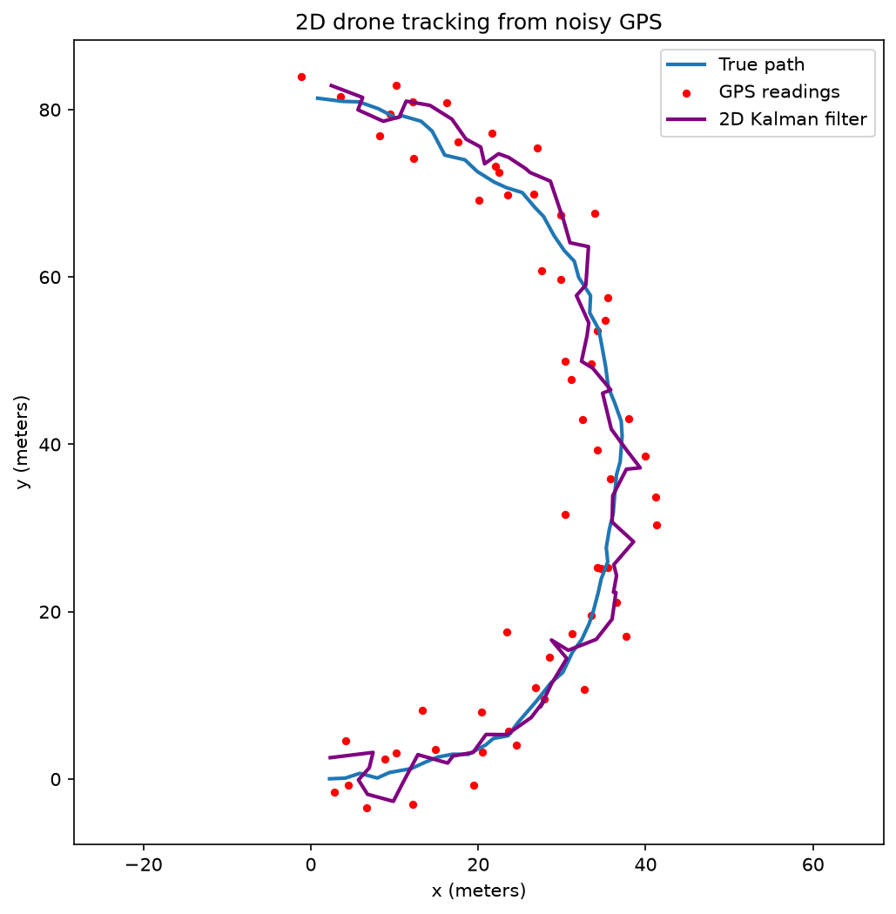
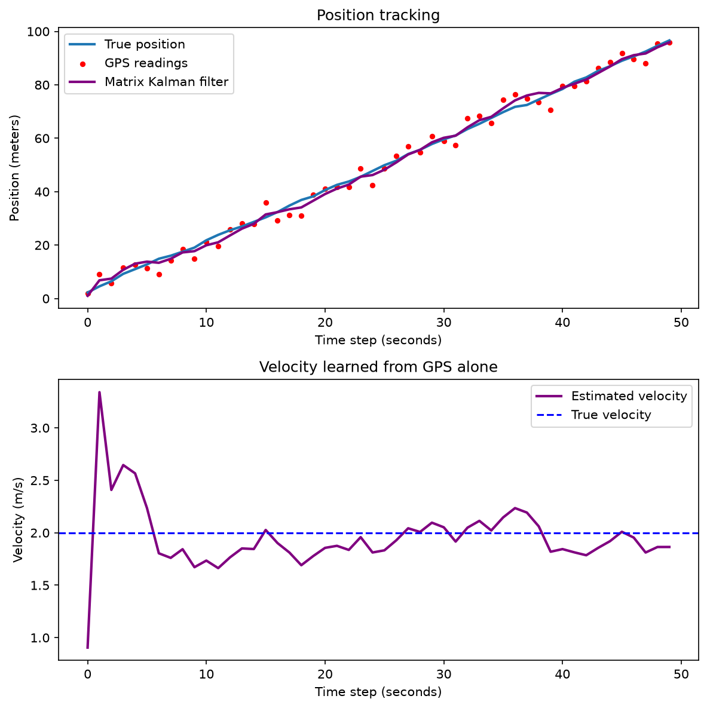

# Kalman Drone Tracker

Tracking a simulated drone from noisy GPS data using Kalman filters, built from scratch in Python with NumPy and Matplotlib. The project builds up in three versions: a 1D filter, a matrix filter that learns velocity on its own, and a 2D filter that tracks a curved flight path.



## The problem

A drone has two imperfect ways to know where it is:

- **Physics prediction**: "I was at 10 m moving 2 m/s, so now I'm at 12 m." Smooth, but small errors (like wind) pile up and it slowly drifts off.
- **GPS**: Never drifts, but every reading is noisy and jumps around by several meters.

They fail in opposite ways. A Kalman filter blends the two, trusting whichever is more reliable at each moment, to get an estimate better than either one alone.

## Results at a glance

| Version | What it does | GPS error | Filter error | Improvement |
|---|---|---|---|---|
| 1. 1D filter | Tracks position, given the speed | 2.93 m | 0.78 m | 73% |
| 2. Matrix filter | Tracks position **and learns speed** | 2.93 m | 1.38 m | 53% |
| 3. 2D filter | Tracks a curved path on a map | 4.25 m | 2.34 m | 45% |

## Version 1: 1D Kalman filter


| Method | Position error (RMSE) |
|---|---|
| Raw GPS | 2.93 m |
| Prediction only | 2.23 m |
| **Kalman filter** | **0.78 m** |

The Kalman filter reduced position error by **73%** compared to raw GPS, beating both of its inputs.

### How it works

Each time step:
1. **Predict:** move the estimate forward using physics (`velocity × dt`) and increase uncertainty by the wind variance.
2. **Update:** compute the Kalman gain `K = uncertainty / (uncertainty + gps_variance)`, slide the estimate part of the way toward the GPS reading, and shrink the uncertainty.

## Version 2: Matrix Kalman filter (learns velocity)

The first filter was told the drone's exact speed. This version isn't: it tracks **position and velocity together** as a state vector and **estimates the velocity from GPS position readings alone**, starting from a guess of 0 m/s.



| Method | Position error (RMSE) | Knew the speed? |
|---|---|---|
| Raw GPS | 2.93 m | — |
| 1D filter | 0.78 m | Yes (given 2.0 m/s) |
| **Matrix filter** | **1.38 m** | **No, estimated ~1.9 m/s** |

The matrix filter uses the standard state-space form:
- **Predict:** `x = F @ x`, `P = F @ P @ F.T + Q`
- **Update:** `K = P @ H.T @ inv(H @ P @ H.T + R)`, then correct both position and velocity from a single position measurement

The off-diagonal terms of the covariance matrix `P` link position and velocity errors, which is what lets a position-only sensor correct the velocity estimate.

## Version 3: 2D tracking on a curved path

The drone flies a U-shaped path on an x/y map. The state grows to 4 values (`[x, y, vx, vy]`) and the matrices grow to 4×4, but the predict/update loop is **identical** to Version 2. The filter starts with no knowledge of the drone's speed or direction.

| Method | Distance error (RMSE) |
|---|---|
| Raw GPS | 4.25 m |
| **2D Kalman filter** | **2.34 m** |

The 2D Kalman filter reduced position error by **45%** while estimating a constantly changing velocity.

## Next steps

- [ ] Tune the process noise (Q) and compare tracking accuracy
- [ ] Test on real GPS data

## How to run

```bash
conda create -n kalman python=3.11 numpy matplotlib -y
conda activate kalman
python simulate.py        # Version 1: 1D filter
python kalman_matrix.py   # Version 2: matrix filter
python kalman_2d.py       # Version 3: 2D filter
```

## Tech

Python, NumPy, Matplotlib