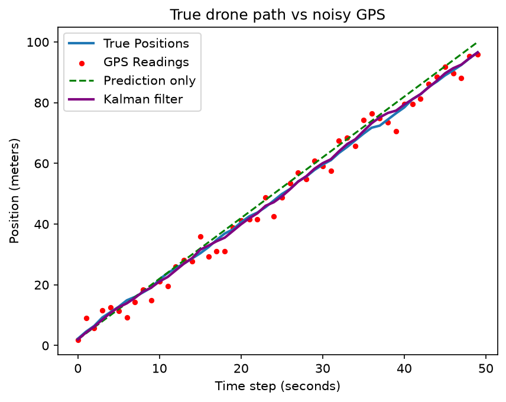

# Kalman Drone Tracker

Tracking a simulated drone's position from noisy GPS data using a Kalman filter, built from scratch in Python with NumPy and Matplotlib.

## Results

| Method | Position error (RMSE) |
|---|---|
| Raw GPS | 2.93 m |
| Prediction only | 2.23 m |
| **Kalman filter** | **0.78 m** |

The Kalman filter reduced position error by **73%** compared to raw GPS, beating both of its inputs.

## How it works

Each time step:
1. **Predict:** move the estimate forward using physics (`velocity × dt`) and increase uncertainty by the wind variance.
2. **Update:** compute the Kalman gain `K = uncertainty / (uncertainty + gps_variance)`, slide the estimate part of the way toward the GPS reading, and shrink the uncertainty.

## Next steps

- [ ] Extend from 1D to 2D tracking
- [ ] Add the results plot to this README